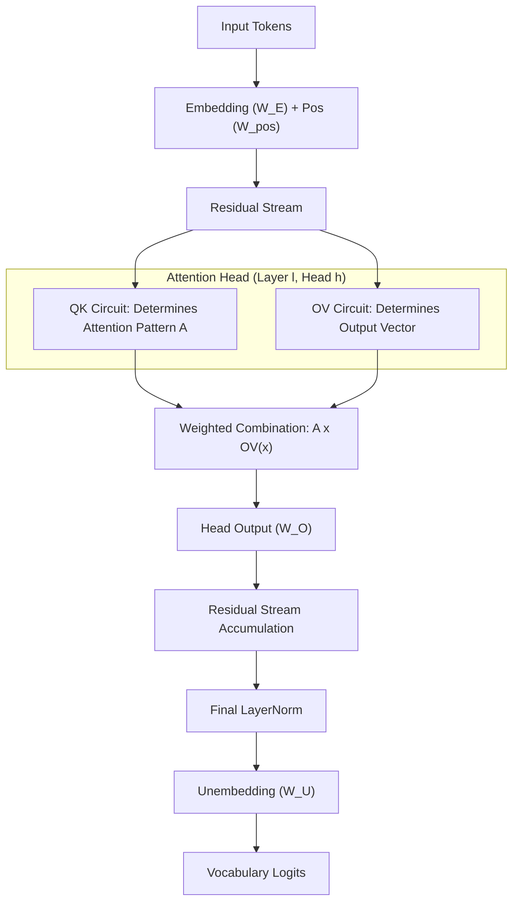
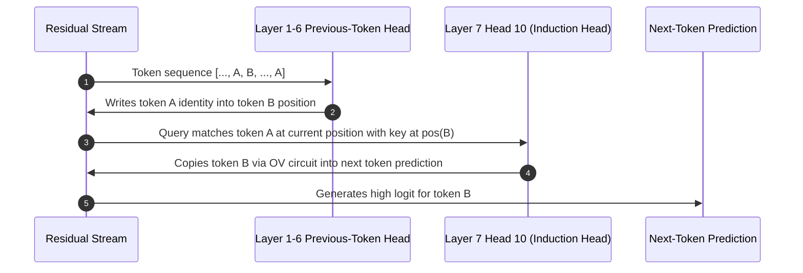

# GPT-2 Small Circuit Interpretability: Attention Heads, Induction Circuits & Direct Logit Attribution

[](https://www.python.org/downloads/)
[](https://pytorch.org/)
[](https://github.com/TransformerLensOrg/TransformerLens)
[](https://opensource.org/licenses/MIT)

A rigorous mechanistic interpretability study dissecting the **117M-parameter GPT-2 Small** architecture (12 layers, 12 attention heads per layer, $d_{\text{model}} = 768$, $d_{\text{head}} = 64$, $d_{\text{vocab}} = 50,257$).

This repository investigates internal computational subgraphs through **behavioral detectors**, **repeated-token sequence induction scans**, **targeted activation ablation hooks**, **low-rank eigenvalue-based OV copying metrics**, and **Direct Logit Attribution (DLA)** onto the unembedding space.

---

## Architecture & Mathematical Foundations

### 1. GPT-2 Small Architecture
* **Parameters**: 117M (weights + biases)
* **Layers ($L$)**: 12
* **Attention Heads per Layer ($H$)**: 12 (144 attention heads total)
* **Residual Stream Dimension ($d_{\text{model}}$)**: 768
* **Head Dimension ($d_{\text{head}}$)**: 64
* **Vocabulary Size ($d_{\text{vocab}}$)**: 50,257

### 2. Attention Circuit Decomposition
Every attention head performs two distinct operations:
1. **Query-Key (QK) Circuit**: Governs *where* information is moved:
   $$A^{l,h} = \text{Softmax}\left(\frac{x^T W_Q^{l,h} (W_K^{l,h})^T x}{\sqrt{d_{\text{head}}}}\right)$$
2. **Output-Value (OV) Circuit**: Governs *what* information is written to the residual stream:
   $$M_{\text{OV}}^{l,h} = W_V^{l,h} W_O^{l,h} \in \mathbb{R}^{d_{\text{model}} \times d_{\text{model}}}$$
   When projected from token vocabulary through embedding and unembedding:
   $$M_{\text{full}}^{l,h} = W_E W_V^{l,h} W_O^{l,h} W_U \in \mathbb{R}^{d_{\text{vocab}} \times d_{\text{vocab}}}$$



---

## Key Findings & Empirical Benchmarks

### 1. Induction Head Identification
On repeated synthetic sequences $[BOS, A, B, \dots, X, A, B, \dots, X]$ of length $S = 50$, induction heads systematically attend to key positions with offset $-(S - 1) = -49$.

| Layer / Head | Induction Score (Offset Stripe Mean) | Query $\to$ Key Mechanism |
| :--- | :---: | :--- |
| **L7H10** | **0.9426** | Primary Induction Head; strong stripe along query 51 $\to$ key 2 (prob: 0.7848) |
| **L5H5** | **0.9409** | Mid-layer Induction Head |
| **L6H9** | **0.9298** | Mid-layer Induction Head |
| **L5H1** | **0.9172** | Mid-layer Induction Head |
| **L7H2** | **0.8840** | Late-stage Induction Head |



---

### 2. Low-Rank OV Copying Eigenvalue Spectrum
The full token-to-token map $W_E W_V W_O W_U$ is of size $50,257 \times 50,257$ (unfeasible to materialize). Because $\text{rank}(W_V W_O) \le d_{\text{head}} = 64$, we exploit the non-zero eigenvalue identity:

$$
\text{spec}_{\ne 0}(AB) = \text{spec}_{\ne 0}(BA)
$$

Letting $A = W_E W_V \in \mathbb{R}^{d_{\text{vocab}} \times d_{\text{head}}}$ and $B = W_O W_U \in \mathbb{R}^{d_{\text{head}} \times d_{\text{vocab}}}$, we compute the spectrum of the $64 \times 64$ Gram matrix:

$$
M_{\text{small}} = B A = W_O W_U W_E W_V \in \mathbb{R}^{64 \times 64}
$$

The **Copying Score** (fraction of positive real eigenvalue mass) is:

$$
\text{Copying Score} = \frac{\sum_i \text{Re}(\lambda_i)}{\sum_i |\lambda_i|} = \frac{\text{Tr}(M_{\text{small}})}{\sum_i |\lambda_i|}
$$

| Layer / Head | OV Copying Score | Description |
| :--- | :---: | :--- |
| **L11H3** | **0.9995** | Near-pure positive eigenvalue spectrum (dedicated copier) |
| **L9H3** | **0.9987** | Late-layer copying head |
| **L10H9** | **0.9987** | Late-layer copying head |
| **L11H11** | **0.9974** | Late-layer copying head |
| **L10H11** | **0.9950** | Late-layer copying head |
| **L7H10** | **0.6739** | Induction Head 7.10 balanced copying score |

---

### 3. Direct Logit Attribution (DLA)
Decomposing the final residual stream into additive per-head components projected onto the target unembedding direction $W_U[:, \text{target}]$:

$$
\text{DLA}(l, h) = \left(\text{LN-scale} \cdot \text{head}_{l,h}\right)^T W_U[:, \text{target}]
$$

**Prompt**: `"The cat sat on the mat. The cat"` $\to$ **Target Token**: `" sat"` (Final model logit: `+16.6119`)

| Rank | Head | Contribution ($\Delta \text{logit}$) | Role |
| :---: | :--- | :---: | :--- |
| 1 | **L10H5** | **+0.7725** | Top primary positive predictor |
| 2 | **L9H9** | **+0.5247** | Secondary positive predictor |
| 3 | **L8H1** | **+0.5169** | Intermediate positive predictor |
| 4 | **L10H10** | **+0.5151** | Positive predictor |
| 5 | **L9H6** | **+0.4624** | Positive predictor |
| 140 | **L6H5** | **-0.1612** | Suppressor head |
| 141 | **L9H5** | **-0.1633** | Suppressor head |
| 142 | **L8H10** | **-0.3699** | Suppressor head |
| 143 | **L11H10** | **-0.6533** | Anti-repetition / inhibitor |
| 144 | **L10H7** | **-0.7279** | Strongest negative attribution |

---

## Repository Structure

```
gpt2-circuit-interpretability/
├── 01_model_architecture_inspection.py     # GPT-2 Small config, weights & shapes inspection
├── 02_tokenization_and_forward_pass.py      # BPE tokenization & logit verification
├── 03_activation_cache_extraction.py        # ActivationCache hook extraction across layers
├── 04_head_behavior_detectors.py            # Current, previous & first token detectors
├── 05_repeated_sequences_induction_setup.py # Synthetic repeated sequence construction
├── 06_induction_head_score_scan.py          # Full 144-head canonical induction stripe scan
├── 07_induction_head_inspection.py          # Detailed pattern dissection of head L7H10
├── 08_induction_scoring_with_hooks.py       # Hook-based non-intrusive induction evaluation
├── 09_targeted_ablation_composition.py      # Upstream V-activation zero-ablation hooks
├── 10_ov_copying_circuit_analysis.py        # OV diagonal token copying analysis
├── 10b_ov_eigenvalue_copying_score.py       # Exact 64x64 Gram operator eigenvalue spectrum
├── 11_k_composition_analysis.py             # Key-composition analysis across layers
├── 12_direct_logit_attribution.py           # Per-head projection onto unembedding direction
├── 13a_single_head_ov_circuit.py            # Isolated single-head output projection
├── 13b_combined_heads_ov_circuit.py         # Multi-head additive residual synthesis
├── run_gpt2_benchmarks.py                   # Automated end-to-end benchmark suite
├── results/
│   └── gpt2_metrics.json                    # Saved empirical benchmark metrics
├── tests/
│   └── test_gpt2.py                         # Unit & synthetic regression tests
├── requirements.txt                         # Pinned dependencies
├── LICENSE                                  # MIT License
└── README.md                                # Architectural documentation & analysis
```

---

## Quickstart

### 1. Installation
Clone the repository and install dependencies:
```bash
git clone https://github.com/PranavBansal7/gpt2-circuit-interpretability.git
cd gpt2-circuit-interpretability
pip install -r requirements.txt
```

### 2. Run Tests
Verify the mathematical operator properties and synthetic detectors:
```bash
pytest tests/ -v
```

### 3. Run Benchmark Suite
Execute the full benchmark runner to extract induction scores, eigenvalue spectra, and direct logit attributions:
```bash
python run_gpt2_benchmarks.py
```

### 4. Run Individual Analyses
```bash
# Scan all 144 attention heads for induction scores
python 06_induction_head_score_scan.py

# Compute the exact 64x64 eigenvalue copying score for L7H10
python 10b_ov_eigenvalue_copying_score.py

# Run Direct Logit Attribution on target prompts
python 12_direct_logit_attribution.py
```

---

## References

1. Elhage, N., Nanda, N., Olsson, C., et al. (2021). *A Mathematical Framework for Transformer Circuits*. Anthropic.
2. Olsson, C., Elhage, N., et al. (2022). *In-context Learning and Induction Heads*. Anthropic.
3. Nanda, N. (2022). *TransformerLens: A Library for Mechanistic Interpretability of Generative Language Models*.
4. Radford, A., Wu, J., Child, R., et al. (2019). *Language Models are Unsupervised Multitask Learners*. OpenAI.

---

## License

This project is licensed under the [MIT License](LICENSE).
